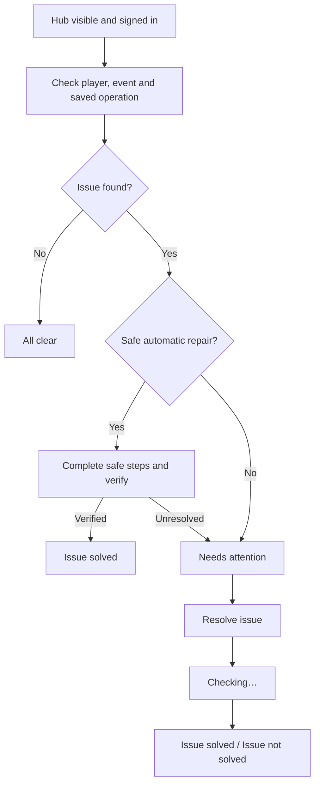

Beauty helps organisers run dart events. It brings together player registration, the organiser’s player list and links to Nakka, the service used for the competition. This handbook is for a helper who has never used Beauty before.

**Working draft — 16 November 2026.** Use the LIVE procedures below for event-day work. The latest confirmed publication is LIVE version 40: it retains the automatic player-recovery engine and approved layout from version 39 and adds league event creation. Historical TEST exercises are kept separately below the everyday instructions. This handbook is the continuing original draft; it has not yet been embedded in the Hub’s Instructions panel.

**Before starting:** sign in, check the selected event title and date, then follow the section for your task. A connection indicator does not confirm every player’s registration. If an action has an uncertain result, inspect its saved result rather than repeat it.

# Understand the parts of Beauty

| Name | What it is for |
| --- | --- |
| Admin Hub | The organiser’s control screen for the event and its players. |
| Kiosk | A shared device where players register themselves. |
| Mobile registration | A registration page players open on their own phones. |
| Beauty Live | The display shown to people at the venue. It is separate from the organiser’s Hub. |
| Nakka | The external competition service that holds event entries and competition information. |
| Event | One particular competition or playing session, identified by its title and date. |
| Player list | The people associated with the selected event. |

**Transfer** means sending players from Beauty to Nakka. **Import** means bringing Nakka entries into Beauty. Neither word means moving to another event. Always read the event title and date before starting either action.

# Know whether you are in TEST or LIVE

**LIVE** is used for real events and real registrations. **TEST** is used to practise and check changes. A successful TEST check does not mean a feature has been released to LIVE.

Use the link supplied by the event organiser. Before making changes, check the environment, event title and date. If you cannot identify them, ask the organiser before continuing. Never use a test fault or diagnostic control during a real event.

# Sign in and sign out

## Sign in

1. Open the Hub link supplied by the organiser.

2. Enter your staff email address and password.

3. Select **Sign in**.

4. Wait for the Hub to finish loading.

5. Check the selected event title and date before changing anything.

If sign-in fails, check that you used the correct staff account and Hub link. Ask the organiser for access if needed. Do not share your password in a screenshot.

## Leave a shared computer

1. Finish the action you are carrying out and read its result.

2. Close any open panel.

3. Use the Hub’s sign-out control.

4. Check that the sign-in page appears. In the TEST Hub, it displays **You are signed out**.

Closing a panel is not the same as signing out. On a shared computer, do not save your password in the browser.

# Select the correct event

**Purpose:** make sure registrations and competition work belong to the intended playing session. **Before you start:** sign in with your organiser account and know the league and date.

1. Open **League / Tournament**, or open **Nakka** and select **FIND OR CREATE EVENT**.

2. Choose **Existing League** and the intended competition.

3. Enter the event date and select **CHECK FOR EVENT**.

4. On **EVENT FOUND**, check the event name and date.

5. Select **START EVENT**.

6. Check the title and date in the Hub header before registering players.

**Expected result:** the selected event appears in the Hub. START EVENT in this selector opens the event in Beauty; it does not by itself prove matches have started in Nakka.

**If it fails:** retain the message and use the saved event-switch recovery when offered. Do not change the spreadsheet’s Control date alone. The selected Hub event and its date must stay together.

**Finish:** close the selector and return to the Dashboard.

# Create an event in an existing league

**Purpose:** create the next playing session when the selected league has no event on that date. **Where:** the same competition/date selector.

1. Choose the league and date, then select **CHECK FOR EVENT**.

2. On **NO EVENT FOR THIS DATE**, select **MAKE NEW EVENT FOR THIS LEAGUE**.

3. Enter an event name.

4. Choose Round Robin, Slutspel, or the combined format. Round Robin means group play; Slutspel means knockout play.

5. Review Slutspel 1 and 2, legs to win, optional dart limits, finals, third-place rules and knockout slots where offered. Check the Monday preset’s values before using it.

6. Select **REVIEW CREATE EVENT** and read the summary.

7. Tick the explicit creation confirmation and select **CREATE EVENT** once.

8. Wait for the result. Use **CONTINUE TO EVENT** if offered, then check the Hub header.

**Expected result:** one new event is created and selected, or the screen offers continuation to that created event. Current registrations are kept in event history; they are not copied into the new event.

**If it fails:** use **Resolve issue** for the saved creation attempt. A missing reply does not mean the event was not created. Do not start a second creation.

**Finish:** return to the Dashboard and register players for the selected event. Standalone tournament creation inside the Hub is not part of this league workflow.

# Register a player from the Hub

**Purpose:** add a person to the selected event. **Before you start:** check the event and ask for the player’s photo/video choice.

1. On the Dashboard, select **+ REGISTER PLAYER**.

2. Search for the player and choose the correct existing name.

3. If the player is absent, use the new-player option and enter their full name.

4. Record the photo/video consent and any message.

5. Submit once and read the result.

6. Check the player’s row and any Needs attention message.

**Expected result:** the registration appears for this event. An existing-name or duplicate warning needs review; it is not a reason to create a second spelling of the same person.

**If it fails:** if the registration was saved but Nakka confirmation is pending, use **Resolve issue**. Do not register the player again to repair the Nakka step.

**Finish:** close the registration screen and return to the player list.

# Register through the kiosk or mobile

**Purpose:** let a player register themselves. The kiosk is the shared venue device; mobile registration is the page on the player’s own phone.

1. Open the established kiosk page or mobile registration link.

2. Check the event title and date.

3. Search for the name and select the correct person.

4. Use **MITT NAMN FINNS INTE I LISTAN** only when the person is not listed. It means “My name is not on the list”.

5. Complete consent and any message, then submit once.

6. Read the confirmation before leaving the screen.

**If it fails:** retain the displayed message and ask the organiser to inspect the registration in the Hub. If the name is already registered, do not create another identity. A closed-registration message means the event/date needs checking.

**Finish:** leave the kiosk ready for the next player. On mobile, the player can close the page after reading the result.

# Understand and change a player row

| Item | Meaning |
| --- | --- |
| IN | Registered as participating. This is not an arrival scan. |
| OUT | Not participating. This is different from deleting a registration. |
| STANDBY | Waiting or reserve. |
| PHOTO & VIDEO | Consent, separate from playing status. |
| MESSAGE | A note left with registration. |
| SOURCE | The original route, such as HUB, KIOSK or MOBIL. |

Use the status dropdown on the correct player’s row to select IN, OUT or STANDBY. Wait for the result and check the refreshed row. Pool Planner excludes OUT and STANDBY players.

Review consent with the player before changing it. Open the message control to read a note, then close it to return to the list. If a change is unconfirmed, preserve its message and use the saved issue rather than repeatedly changing the value.

# Remove a player from this event

**Purpose:** remove the event registration and its Nakka event entry while keeping the league profile. **Where:** the trash icon on the player’s row.

1. Select the correct player’s trash icon.

2. Read **Remove [player name]?**

3. Select **Remove player**, or **Cancel** to leave the registration in place.

4. Wait for the result.

5. A verified result shows a green tick and **Removed**.

6. Close the result and check the refreshed player list.

**If it fails:** use the saved removal’s **Resolve issue** route. Do not remove the player again because the first reply was slow. References and timings belong under **Advanced**.

**Finish:** confirm that the intended player is no longer in this event’s list. The simplified screen does not imply that removal is instantaneous.

# Compare Beauty and Nakka

**Purpose:** identify differences between the selected event’s lists. **Where:** **Nakka** in the side menu.

1. Check the event title at the top of the panel.

2. Read the API connection status and checked time.

3. Select **COMPARE LISTS**.

4. Review Hub and Nakka totals, then the difference categories.

| Result | What to do |
| --- | --- |
| Hub only | Check status and the saved registration before transferring. |
| Nakka only | Review the event and identity before importing. |
| Duplicate names | Review which permanent player identity is correct. |
| Dashes before comparison | No current comparison is available; dashes do not mean zero. |

Matching names alone do not prove permanent player identity. **API connected** means the connection check succeeded, not that every registration is correct.

**If there is a difference:** use the named player’s Needs attention / **Resolve issue** path. **Advanced** contains detailed comparisons, the queue and existing transfer/import/recovery tools. Review the proposed action before confirming it.

**Finish:** close Nakka and return to the Dashboard.

# Prepare and send pools

**Purpose:** arrange eligible players into groups before competition play. **Where:** **Pool Planner**. **Before you start:** select the correct event and resolve registration/identity issues.

1. Load or refresh league statistics using the available statistics control.

2. Review the proposed player identities. Missing averages remain **Unseeded**.

3. Generate the preview using **GENERATE PREVIEW** where offered.

4. Inspect every pool. Use the available swap controls to adjust the preview.

5. Choose physical boards and review their assignments.

6. Check competition format and game settings, then select **REVIEW & SEND**.

7. Read the reviewed pools and settings. Close Nakka editing pages.

8. Tick the final confirmation and select **SEND TO NAKKA** once.

9. Wait for the group and match-card readback.

**Expected result:** the send is verified. A preview or **DOWNLOAD BOARD PLAN** file is only a plan, not proof of a successful send. Unresolved players may be previewed, but sending requires the necessary league identities and event entries.

**If it fails:** recover the saved pool operation. Do not send a fresh preview to compensate for an uncertain reply.

**Finish:** check the saved result before play. The Hub reviews physical board plans; Nakka controls live match assignment.

# Open Beauty Live

**Purpose:** display the event to players and spectators. **Where:** **Live** in the Hub.

1. Open the audience display and check its event title and date.

2. Use fullscreen if needed.

3. Select the appropriate stage.

| Label | Meaning |
| --- | --- |
| KVÄLLENS SPELARE | Tonight’s players |
| GRUPPSPEL | Group play |
| SLUTSPEL 1 / SLUTSPEL 2 | Knockout stages |
| SPELARE | Player |
| SNITT | Average |

The display refreshes itself and adjusts the player layout as the list grows. Allow it to refit after a screen-size or fullscreen change.

**Sorting:** **Alfabetisk ordning** sorts names; **Anmälningstid** sorts registration times. **Ligapoäng (Nakka)** depends on usable matched league-points data. It is disabled with an empty roster; this alone does not indicate a broken connection.

**If the display is empty:** check the selected event and Hub roster first. **Inga spelare anmälda ännu** means no registered players are currently shown.

**Finish:** leave the audience display open as needed and use the Hub for organiser actions.

# Find registration history and finish your session

**PLAYER’S MASTER LIST** contains reusable player names. The current registration/player sheets are working lists for the active event. The recovered historical responses are presently readable in **BEAUTY EVENT HISTORY**. An empty current response list alone does not prove the old registrations were deleted.

Switch events through the Hub’s guarded event-selection workflow. It archives the current registrations rather than copying them into the next event. Resolve pending saved operations before switching.

To finish at a shared computer, read the result of the current action and sign out using the steps above. **Signing out is not the same as finishing a competition in Nakka.** A full competition-completion procedure still needs current screen verification; do not infer it from START EVENT, switching dates or signing out.

# Understand recovery

An action can save successfully even if its reply or display refresh fails. For example, a player’s information may be saved while the screen still needs updating. Repeating the original registration or transfer can create confusion or duplicates.

**Recovery** means inspecting the saved result and completing only the work that remains. In the simple LIVE screens, use **Resolve issue**. Older saved-operation tools may say **RECHECK**; this checks the existing operation and does not mean “register this player again”.

| Message | Meaning | What to do |
| --- | --- | --- |
| Reading or checking | A request is still running. | Wait for the result. Do not click repeatedly. |
| REVIEW or needs review | Beauty cannot yet confirm that the whole operation is complete. | Read the explanation. Use the recovery control for that saved operation when instructed. |
| VERIFIED | The checks for that operation succeeded. | Read the result and continue. This applies to that operation, not every part of the system. |
| Reply was not received | The screen does not know the result of the request. | Read the saved receipts before deciding what to do next. Do not assume nothing was saved. |

# Recognise the recovery colours

Player recovery uses red, orange and green to distinguish an issue needing review, an operation being checked, and a verified result. Technical details stay under **Advanced**. Historical TEST diagnostic examples below are demonstrations, not current player problems.

| Colour | Meaning | Operator response |
| --- | --- | --- |
| Red | Beauty needs help with this player’s specific problem. | Open the card, read the explanation and follow the numbered steps. |
| Orange | Beauty is checking or attempting eligible recovery automatically. | Let it finish; do not register or transfer the player again. |
| Green | Recovery for this item has been verified. | No action needed; the history can explain what happened. |

Read the message as well as the colour. Green confirms that item’s recovery, not the health of the whole system. The automatic player-recovery engine is included in the confirmed LIVE version 39 release and retained in version 40.

## How automatic player recovery works

Keep the Hub visible and stay signed in as an authorised organiser. Beauty checks the selected event, player identities and saved operations. It can complete safe missing steps, but it does not blindly repeat an operation whose result is uncertain.

**Automatic work:** check unfinished registrations, verify saved operations and complete eligible missing event-entry steps. Temporary connection problems may be checked again; automatic retries are limited.

**Review needed:** conflicting identities, uncertain removals, profile creation requiring explicit confirmation, closed events and unresolved results. This is player-centred recovery, not an engine that automatically fixes every part of Beauty.

## Resolve an issue in LIVE

**Purpose:** verify or safely complete a saved action. **Where:** the named player’s **Needs attention** item or the relevant saved operation in **Recovery**.

1. Open the issue and confirm the player and event.

2. Select **Resolve issue**.

3. Wait while **Checking…** is shown.

4. If **Issue solved** appears, close the result and check the refreshed list.

5. If **Issue not solved** appears, read the short reason and open **Advanced** for the next step.

6. Review any proposed identity choice or explicit confirmation before proceeding.

**If it remains unresolved:** keep the original reference and message for support. Do not create a new registration, removal or event-creation attempt to replace an uncertain one.

**Finish:** return to the Dashboard. Recovery runs while the authorised Hub is visible; it is not an unattended service that keeps running after the Hub is closed.

# Historical development and acceptance records

The following TEST exercises and dated release notes are retained as evidence. Their availability statements describe those checkpoints; they are not instructions to repeat diagnostics during an event. Use the LIVE chapters above for ordinary work.

# TEST player recovery during registration

**Availability:** the corrected popup is installed in TEST. Reload the TEST Hub to load the new page. Closed-event cards should immediately explain the problem and offer **Go to player list**, without a transfer retry. Copy report should remain available during background checks. These behaviours passed local checks; post-reload native visual confirmation remains pending. This is not yet a LIVE procedure.

## Let Beauty check first

1. Sign in to the TEST Hub and check the selected event title and date.

2. Beauty checks the selected event automatically while the Hub is open. You do not need to verify each player.

3. Open **Recovery** or an affected player’s compact **Needs help**, **Checking** or **Resolved** badge.

4. For a red card, read the player-specific explanation and follow its numbered steps. Confirm a reviewed action only when the displayed player and event are correct.

5. Once resolved, the item becomes green. Open **Issue history and report** or use **Copy report** to retain the explanation. Select **Close** to return to registration.

In the prepared correction, ordinary players and unchecked players do not appear as individual recovery tasks. A pending or failed event check is shown once at event level. **Not yet verified** in the older interface is not an instruction to verify every player manually. The original player table and diagnostic controls remain in place.

## Registration is closed

An event that has finished must not accept new registrations. The prepared correction checks Nakka’s event status before saving through Hub, kiosk or mobile. If the event is closed, the message says **Registration is closed** and **Nothing was saved**. Select the correct upcoming event before trying to register there. If the status cannot be checked, nothing is saved.

A registration already saved by the older version needs a different response. If you know it was a mistaken late registration, close the recovery popup, find the player in the Hub player table and change **IN** to **OUT**. This preserves the original registration and excludes the player from the IN list. Do not reopen the completed event or repeat the transfer to make the warning disappear. If the status change does not confirm, retain the message and ask for support; do not delete the registration row.

[historical test player] in the completed AIK Hub TEST 2026-11-07 event was the observed example. The report showed **TEST_TARGET_ONLY** after the Hub registration had already saved. The owner’s 23:22 screenshot shows him as **OUT**, but still with a Needs help badge. The Remove player popup refused removal because the event had completed. OUT excludes him from the IN list; it does not delete his saved registration. The owner confirmed that this issue did not block the TEST system. Complete cleanup and warning clearance remain unresolved.

## Matching lists and recovery checks

**COMPARE LISTS** compares names. Sixteen matching names and zero missing or duplicate names do not prove every identity or earlier operation is verified. Beauty’s automatic recovery check also examines the selected event, identities and saved operations.

The prepared correction fixes an expired-timestamp problem: repeated successful checks retained an old individual timestamp, which Recovery mistakenly treated as unchecked. It now uses a fresh completed check of the same roster. A failed or stale check must not be shown as green.

## Meaning of workspace

A **workspace** here means the separate spreadsheet used for a particular TEST exercise. **SEPARATE RECOVERY TEST WORKSPACE** is a diagnostic area, separate from the event selected at the top of the Hub. You do not need its preview or recheck controls for ordinary player registration. Completed diagnostic exercises should stay completed.

**Owner decision at pause:** keep the diagnostic tools and their records in the system, hidden during normal operation and revealed only when needed. This replaces the earlier request to leave those controls visible. Implementation was stopped before any cleanup or visibility change was made; the controls may still be visible in the installed TEST page. Do not delete diagnostics or resume development until the owner asks.

## Approved removal layout queued on 16 November

The approved design was installed in TEST using **Beauty-TEST-Simple-Screens-20261116.cjs** on 16 November 2026 at 12:38 Stockholm time. The owner’s installer log reports TEST_LAB_INSTALLED, full source readback, 37 files preserved, one changed and none added. The owner’s 12:47 screenshot confirms the compact removal confirmation is displayed. It differs from the mock because its buttons are smaller and side by side. The owner explicitly accepted keeping this layout for now. The Removed and unresolved result screens have not yet been observed natively. Confirmation shows **Remove [player name]?**, **Remove player**, **Cancel** and collapsed **Advanced**. Clicking Remove player is the explicit confirmation; the existing server preview and save guards remain. Verified success shows a green tick and **Removed**, with a close control. An unconfirmed result shows **Issue not solved**, a short explanation, **Resolve issue**, **Close** and collapsed **Advanced**. Resolve issue opens the existing Recovery tools; it does not repeat the removal or promise automatic repair. The last removal report remains under **Advanced — removal report** in Recovery. The corresponding LIVE layout and removal verification correction have now been published as version 37. Native LIVE visual acceptance is still pending.

The same installed TEST update applies the approved design to **Needs Attention**: **Checking…**, followed by either a green tick and **Issue solved**, or the player's name, **Issue not solved**, one short reason, **Resolve issue**, **Close** and collapsed **Advanced**. **Resolve issue** replaces Check result and Check after correction in this popup. A guarded action that needs confirmation still states its effect before the organiser clicks. Closed-event issues lead to the player list for the appropriate OUT correction; they do not retry a transfer. Technical reports, detailed guidance and source links remain under Advanced. This is installed TEST source. Native visual acceptance of the Needs Attention result screens remains pending. LIVE version 37 now applies the same simple result presentation to its existing saved-operation and registration-queue controls. It does not copy TEST recovery services into LIVE; native LIVE visual acceptance remains pending.

The simplified removal and Needs Attention screens are installed as one TEST HTML update, confirmed by the owner’s 12:38 installer log. The removal confirmation was observed in the owner’s 12:47 screenshot and accepted as shown. No new removal or Cancel result was supplied. Other result screens remain without native visual acceptance; no further deletion is required just to review the confirmation. Seven focused DOM checks and four installer checks passed. Browser rendering could not run in the current workspace, so visual acceptance is not claimed. Bulk removal remains requested but not built. The focused removal comparison is installed in TEST, with 37 other source files preserved. On 16 November the controlled removal check passed in the separate event **AIK Hub TEST Removal 2026-11-16.** within **Beauty TEST — DO NOT USE LIVE**. Two existing test players were registered with status IN and photo/video consent NO. Removing **Beauty Test Mobile 02 Nov** returned a successful removal message without a manual Recovery step. The final dashboard showed only **Beauty Test New 02 Nov**, still IN, consent NO, source HUB, with **Needs Attention 0** and a green Nakka event verification indicator.

The measured preview wait was **7.7 seconds** (server 4.6 seconds), and the removal wait was **39.6 seconds** (server 23.6 seconds): **47.3 seconds of application waiting in total**, excluding time spent reviewing and confirming. This is a functional TEST pass, not a speed improvement. The success message reported the league profile was kept; no separate manual league/master-list inspection was performed. The TEST reader has fewer display fields than LIVE, so this native result confirms the adapted TEST flow. The original LIVE extra-field defect and correction were covered by nine local checks; five additional focused checks covered the TEST adapter and installer. No further native deletion is required for this same acceptance check.

Before this test, the TEST spreadsheet was found linked to tonight’s LIVE Nakka event **t_yIw0_7809**. No test players were registered or removed there. The owner selected **Beauty TEST — DO NOT USE LIVE**, checked 16 November, and created the separate test event once, using **Round Robin only**. No pools were sent or competition started. This selection resolved the immediate test-target blocker, but the underlying ability to select a LIVE Nakka event from TEST remains a separate open issue. The TEST banner alone does not prove Nakka isolation. The approved LIVE update has now been published and verified as version 37. The owner paused the timing work, then requested the next queued item. The simple screens are installed in TEST and the owner has accepted the observed removal confirmation layout. The two-file LIVE candidate passed the owner-run read-only source review at 13:07 Stockholm time. The owner explicitly approved publication after the read-only check. The owner ran the approved publication command and supplied PRODUCTION_DEPLOYED_VERIFIED with PUBLISHED_VERSION: 37. Performance and the TEST-isolation guard remain paused. The approval covers only this reviewed two-file LIVE package.

**LIVE version 37 published and verified — 16 November:** the owner ran the approved Beauty-LIVE-Simple-Screens-20261116.cjs publication and supplied **PRODUCTION_DEPLOYED_VERIFIED** with **PUBLISHED_VERSION: 37**. The audit folder is **Beauty-LIVE-Simple-Screens-2026-11-16T12-13-30-647Z-dwbXWw** in Downloads. The installer read back the source and frozen version, updated the pinned deployment and verified it. Its repeated “previous version” messages were readback checks, not repeated publication. This release changes only the Hub interface and the six-field removal verification comparison; 26 other files are preserved by the package. It provides simple removal and issue results with Resolve issue and collapsed Advanced, using the existing LIVE saved-operation and registration-queue controls. The installer ran no Beauty function and changed no Sheet, Nakka, Git or credential file. The owner’s console log is the publication evidence; the assistant has not independently inspected the audit folder. Reload the LIVE Hub to load version 37. A removal preview followed by Cancel can check the layout without deleting anyone. Native LIVE visual and event-day acceptance remain pending. Performance work and the TEST-isolation guard remain paused; bulk removal is not included. Six focused UI checks, five release safeguards and the earlier nine checks for the unchanged removal correction remain the local evidence; no further tests were run just to record publication.

**Owner workflow decision — LIVE only, 16 November:** all further development must use the current LIVE source as its working baseline. The layouts and behaviours already approved in TEST are the intended LIVE result, not suggestions for a different redesign. Do not maintain a separate TEST implementation or silently publish a subset as though the complete approved workflow has moved. Back up LIVE, retain its guarded actions, and use the owner's explicit approval for the concrete publication scope.

**LIVE version 39 published and verified:** the owner returned PRODUCTION_DEPLOYED_VERIFIED with PUBLISHED_VERSION: 39 for Beauty-LIVE-Complete-Recovery-20261116.cjs. The audit folder is `/Users/alessiotampella/Downloads/Beauty-LIVE-Complete-Recovery-2026-11-16T13-21-56-982Z-T3je3z`. This includes the approved Nakka card layout, compact sidebar, direct Recovery, simple results and LivePlayerRecovery. The installer read back all source and the published version without running a Beauty function or modifying Sheet, Nakka, Git or credential files. Publication verification is not a recorded native visual or real-player recovery check.

**Additional automatic recovery is included in published LIVE version 39:** while an authenticated Hub is visible, it checks player issues, resumes eligible interrupted registrations through their original queue jobs, fills verified missing fields from the unique original response, transfers eligible IN players with confirmed existing identity into an open event, and verifies saved operations. Uncertain adds are never repeated. A missing league profile or changed identity requires explicit review; closed-event requests and unresolved partial operations remain Issue not solved. The engine does not reopen events or automatically mark players OUT. Recovery and player badges lead to Checking, then Issue solved or Issue not solved, with Resolve issue and details under Advanced. Fourteen focused engine checks, five interface fixtures and six release safeguards passed locally; no remote Beauty function or player mutation was run. The owner’s publication result confirms this source is now deployed. Bulk deletion and removal timing improvements remain pending. The separate event-creation update below is prepared against version 39.

**Approved league event creation prepared for LIVE:** Beauty-LIVE-Event-Creation-20261116.cjs adds the finished find/create flow to version 39. Choose League / Tournament → Existing league → date → MAKE NEW EVENT FOR THIS LEAGUE. The approved form offers Round Robin, either Slutspel, legs/dart limits/finals/third place and the Monday preset. Review the settings, acknowledge creation and select CREATE EVENT. The current event’s registrations are retained through the existing LIVE archive/switch system; preview does not change the selected event or date. Lost creation replies use Resolve issue and the original receipt without sending a second create. Three existing files change, one module is added and all other 26 files are preserved. Eight focused engine checks, four interface fixtures and five release safeguards passed locally. Run `node "$HOME/Downloads/Beauty-LIVE-Event-Creation-20261116.cjs" --approve-live` after downloading the installer. Its publication result is pending; no actual event was created during preparation. Bulk deletion and deletion speed work are still unfinished.

# TEST only Read saved recovery results

These sections describe supervised TEST diagnostics. Open **Recovery**, then the named diagnostic section. They are not the everyday player-recovery procedure. Keep these tools in their existing location; do not rerun completed exercises to operate the Hub.

## Separate recovery workspace TEST

**Native TEST result on 15 November 2026:** the owner’s final workspace screenshot shows all four controlled repairs as **COMPLETE**: TRANSFER FAULT, TRANSFER CHECK, IMPORT CHECK and IMPORT FAULT. The import-fault sequence also showed **Imported and verified** before the refreshed list displayed COMPLETE. This supersedes the earlier partial-setup instructions. Do not repeat setup, deliberate interruptions or repair confirmations.

This section uses **Beauty Recovery TEST 2026-11-15 R1**, its own workbook and its own master list. It is separate from the event shown at the top of the main Hub. No Form is linked. Open **Recovery → SEPARATE RECOVERY TEST WORKSPACE → CHECK WORKSPACE** to inspect it. Opening the section alone makes no request. Do not repeat workspace creation, connection initialization, or the old formula Setup/Interrupt.

### Completed setup and repair exercise

The earlier entry-ID inspection and setup-resume instructions are historical. The separate workspace is now populated and its four controlled repair results are COMPLETE. Preserve its records and audit folders. No new fixture setup is required for the player recovery correction.

### Historical supervised repair sequence

The table records the controlled test procedure and its expected results. The owner’s later screenshot shows all four final repairs COMPLETE. It is retained to explain the test, not as a request to run it again.

| Order | Exact player name | Action and expected result |
| --- | --- | --- |
| 1 | BEAUTY TEST R1 TRANSFER FAULT | PREVIEW TRANSFER. Confirmation deliberately discards the add reply and interrupts immediate readback. Expected REVIEW with TEST_TRANSFER_READBACK_INTERRUPTED. Keep its saved reference. |
| 2 | BEAUTY TEST R1 IMPORT CHECK | PREVIEW IMPORT while the first transfer is still pending. Expected COMPLETE. This checks whether an unrelated import can finish. |
| 3 | BEAUTY TEST R1 TRANSFER FAULT | CHECK WORKSPACE, then RECHECK SAVED RESULT beside this repair. Expected COMPLETE without sending another add. |
| 4 | BEAUTY TEST R1 TRANSFER CHECK | PREVIEW TRANSFER. Expected COMPLETE. |
| 5 | BEAUTY TEST R1 IMPORT FAULT | PREVIEW IMPORT. Confirmation deliberately interrupts the display after source records are saved. Expected REVIEW with TEST_IMPORT_DISPLAY_INTERRUPTED. Then CHECK WORKSPACE and RECHECK SAVED RESULT; expected COMPLETE without another source append. |

A deliberate interruption is labelled **CONTROLLED TEST**. These interruptions apply only to the named synthetic players in the separate workspace. They are not normal event behaviour and are not part of event-day recovery.

### Understand results and limits

Transfer sends one uniquely registered IN player to Nakka using an existing league identity. The repair tool never creates league members; only the owner’s controlled fixture setup does that here. Import brings one Nakka entry absent from this workbook into Beauty with consent **N/A**. Its chosen event-window timestamp is not the original Nakka registration time. Preview saves a ten-minute review ticket but changes no player records.

If a reply is missing, select **CHECK WORKSPACE**, then **RECHECK SAVED RESULT** for that operation. Do not confirm again. Recheck can inspect an attempted write and rebuild the derived display, but cannot resend an add or append. Keep the reference if it remains REVIEW.

A changing Nakka list can make an uncertain earlier transfer require review. Beauty must inspect the existing entry and preserve the original operation record, rather than repeat an uncertain add. Local tests cover guided existing-entry review and other arrivals; broad native event-day acceptance remains pending.

### Existing menus and monitoring

The installed Nakka/Recovery layout, existing controls and completed formula exercise remain available. Player checks run every 30 seconds while the Hub is visible; API health is separate at five minutes. Green means verified clear, orange checking or incomplete, and red a reported issue. Colour preview cards are examples. The approved TEST visuals and LIVE’s existing recovery capabilities remain recorded in the promotion map; nothing in this test package deploys LIVE.

1. Sign in to the TEST Hub and wait for it to load.

2. Select **Recovery** directly from the Hub side menu.

3. Check the test event title and synthetic player shown at the top.

4. Read each card’s saved result. **Last result: verified** describes a saved result; opening the panel does not run a new recovery check.

5. To read the saved results again, select **REFRESH RECEIPTS**.

6. When instructed to check an operation, select **RECHECK** beside that specific card once.

7. Wait for the result message. Do not switch to another action while the check is running.

8. If it reports **VERIFIED**, read the accompanying explanation. If it still needs review, preserve the message and ask the organiser or support person to inspect it.

9. Select **CLOSE** when finished.

The panel can scroll. If a heading or control is outside the visible area, scroll inside the panel.

## If the reply is lost

Select **REFRESH RECEIPTS** to read the saved state. Do not repeat a confirmation simply because its reply was lost. If the saved state remains unclear, record the event title, affected operation, exact message and approximate time, then ask for help. Do not delete records or clear saved receipts to make an error disappear.

# TEST only Preview the colours

1. Select **Recovery** from the Hub side menu.

2. Expand **COLOUR PREVIEW — DISPLAY ONLY**.

3. Compare the red, orange and green example cards.

4. Collapse the preview when finished.

These are examples, not current issues. Opening this section makes no server request and changes no records. There is no RECHECK button on the examples.

# TEST only Understand the unfinished operation exercise

This exercise is for a supervised test session. It deliberately interrupts the display refresh for a synthetic player whose source information is already saved. It does not add a player or append a registration row. Do not run it as an everyday repair procedure. The exercise rebuilds a separate test display directly. It does not check the formulas that populate the normal player list or the Google Form connection. A green result here therefore does not confirm that normal registration recovery is ready. The read-only event/workbook connection check passed on 15 November at 16:10 Stockholm time. The actual TEST player-list formulas have been inspected. The TEST editor showed zero triggers for the current account; the workbook menu showed Create a new form. These observations do not establish that no other account or script can write data. Full registration recovery remains unfinished.

1. Open the authorised **Recovery TEST** panel.

2. Under **Unfinished operation test**, select **PREVIEW TEST**.

3. Read the preview. If it is accepted, a **CONFIRM DISPLAY TEST** button appears. The preview is valid for ten minutes.

4. Only when instructed to run the exercise, select **CONFIRM DISPLAY TEST** once.

5. The expected result is **REVIEW** with `TEST_UNFINISHED_DISPLAY_FAILURE`. In this exercise, that message confirms the deliberate interruption.

6. Find the **Unfinished operation recovery** card and select its **RECHECK** button once.

7. Wait for **VERIFIED**, then check that the card shows a verified result.

If the expected message does not appear, stop and preserve the actual result for inspection. If confirmation’s reply is lost, refresh receipts rather than confirming again. A completed exercise does not need to be repeated to check the colours.

# TEST only Check recovery with real spreadsheet formulas

**Completed successfully in native TEST on 15 November 2026 at 16:47 Stockholm time.** The corrected diagnostic resumed the preserved setup, deliberately interrupted the synthetic player's display update, and recovered it using the real spreadsheet formulas. No source rows were appended during recovery, no Nakka calls were made, and the original event tabs and earlier receipts were verified unchanged. The provider was simulated, so this result does not establish full normal Hub or Nakka integration. The sequence below documents the supervised exercise; it is not a request to repeat it. The normal-Hub connection was subsequently installed and its isolated current-result check and recheck were verified in the owner's TEST Hub. It connects only this isolated formula fixture; full real-event recovery remains unfinished.

The test copies the inspected player-list formulas into these isolated tabs. It creates one synthetic player to preserve and one synthetic player whose status update will be interrupted. Nakka is simulated: no Nakka request is made. A successful result will verify this formula exercise, not release recovery to LIVE.

1. With the TEST editor closed, install Beauty-TEST-Formula-Readback-Fix-20261115.cjs from Terminal. It updates only the existing formula diagnostic, preserves the other 35 source files and leaves deployment settings unchanged. It does not run a function or change spreadsheet records. Return the installer result first.

2. After TEST_LAB_INSTALLED or ALREADY_INSTALLED, reopen the TEST script editor and select BeautyFormulaRecoveryTest20261115.gs.

3. Select beautyTestFormulaResumeSetup20261115 and click Run once. Use Resume Setup for the preserved failed setup, not the original Setup function. It verifies the existing source rows, tab identities, formulas and receipts, then rebuilds the fixture status display. It creates no tabs and rewrites no source rows or formulas. Expected result: FORMULA_TEST_READY with resumedExistingSetup: true. Send the execution log before proceeding to interruption.

4. When instructed, run beautyTestFormulaInterrupt20261115 once. It saves an operation receipt, clears only the synthetic target's display status and deliberately interrupts refresh. Expected result: FORMULA_RECOVERY_REVIEW with TEST_FORMULA_DISPLAY_INTERRUPTED.

5. Run beautyTestFormulaRecheck20261115. Expected result: FORMULA_RECOVERY_VERIFIED. Recovery updates only the test display status column and its own receipt; it must preserve both source records, all formulas, the other synthetic player, original event tabs and earlier test receipts.

6. Once FORMULA_RECOVERY_VERIFIED appears, retain the saved result and stop. This exercise is now complete; no further interruption or setup run is needed. Never use these diagnostic functions during a real event.

If a reply is lost after interruption, use RECHECK instead of repeating interruption. If setup stops with FORMULA_SETUP_INCOMPLETE_PRESERVE_EVIDENCE, keep its partial tabs and log for inspection; do not rerun setup or delete its evidence. A changed source, formula, event or receipt must be inspected before continuing. These are diagnostic procedures, not everyday operator repair instructions.

# TEST only Check the formula result through the Hub

**Installed and verified through the owner's TEST Hub — 15 November 2026, 17:13–17:14 Stockholm time.** CHECK CURRENT RESULT showed VERIFIED at 16:13:15.019Z; after the instructed RECHECK ISOLATED DISPLAY action, the owner supplied a second VERIFIED result at 16:14:19.030Z. Both displayed original receipt unchanged, no source rows appended and no Nakka calls. This confirms the isolated Hub path with a simulated provider, not real-event recovery or a newly injected interruption. The steps below document the completed acceptance; no repeat is needed.

1. Close the TEST Apps Script editor. Download Beauty-TEST-Normal-Hub-Recovery-20261115.cjs to Downloads and run it from Terminal with Node. It checks the fixed TEST project, saves a backup, changes two Hub files and adds one adapter. It preserves 34 other files and does not deploy or execute Beauty functions.

2. Return the installer log first. If it reports STOPPED, preserve its audit folder and exact error; do not bypass its source checks. Do not repeat formula Setup or Interrupt.

3. Reload the existing owner TEST Hub editor-preview URL and sign in. Open **Recovery**, then find **Real-formula check · isolated TEST**. The owner supplied screenshots of this section and its verified results on 15 November 2026.

4. Select **CHECK CURRENT RESULT**. This reads the saved result and checks the current isolated display without writing spreadsheet cells. Expected result: **VERIFIED**, with a check time and an explicit statement that the provider is simulated.

5. **RECHECK ISOLATED DISPLAY** becomes available after a successful current-result check. It can rebuild only the isolated display status column from already-saved source records. It cannot append source rows, contact Nakka, recreate the test or rewrite its original receipt. Use this only during supervised TEST acceptance; it is not an event-day repair button.

6. If a reply is lost, use **CHECK CURRENT RESULT** before another recheck. After a 60-second timeout, close and reopen Recovery, then check the current result. No request is repeated automatically. If the event changes or the session expires, reopen the panel after selecting the correct TEST event and signing in.

7. Keep the displayed result for review, then close the panel. A verified isolated result does not release normal event recovery to LIVE.

# Get help without repeating an uncertain action

Tell the organiser or support person:

- Whether you are using TEST or LIVE.

- The event title and date.

- Which screen and button you used.

- The exact message and approximate time.

- Whether the player is already visible in Beauty or Nakka, if you can check without making changes.

Include a screenshot if useful, but leave passwords and other credentials out. Keep the original records and saved recovery information intact.

# Remaining coverage and publication status

LIVE event selection, league event creation, registration, player rows, removal, Nakka comparison, Pool Planner, Beauty Live and issue resolution now have everyday chapters above. Detailed standalone import/transfer sequences, competition controls and the full competition-completion procedure still need current-screen verification before adding exact clicks. The permanent change to stop new per-operation recovery tabs and the wider cast tabs/larger headings were prepared separately; their publication remains unconfirmed in the available logs.

The future Instructions side panel will present the relevant chapter beside each task, with search across headings, procedures, button names and error messages. Search results will show a short excerpt and open the matching section; everyday phrases such as “player missing” should lead to relevant help. This draft and its search have not yet been installed in that panel.

